# Boutique Diayma

Application web de boutique en ligne (ASP.NET Core MVC) : liste de produits, panier, commande, interface multilingue (anglais, français, **wolof**).

Ce dépôt contient le code du TP, avec les réponses aux questions, les bugs trouvés et corrigés, et la trace d'exécution pas à pas.

---

## 1. Récupération et exécution (Q1)

L'application est execute et accessible sur http://localhost:62929/
 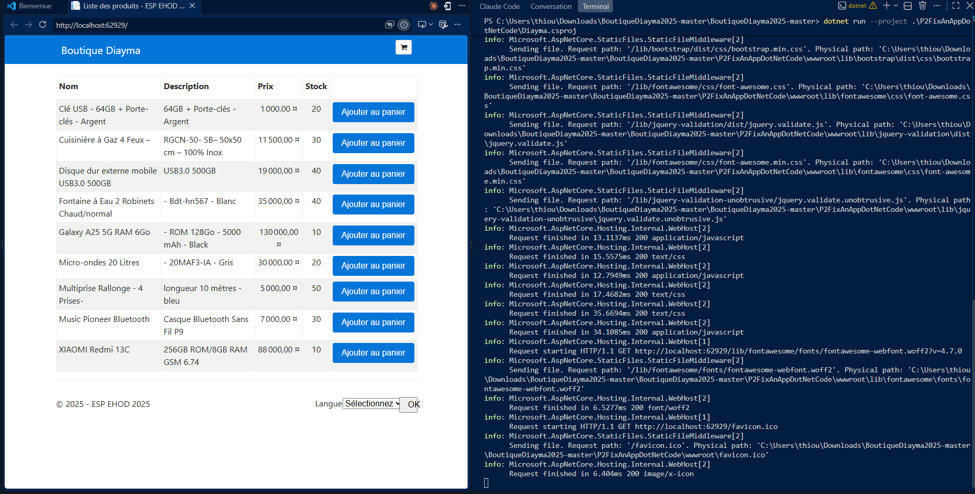

## 2. Projets de la solution (Q2)

La solution **`Diayma.sln`** contient **un seul projet** :

| Projet | Dossier | Type |
|---|---|---|
| `Diayma` (`Diayma.csproj`) | `P2FixAnAppDotNetCode/` | Application web ASP.NET Core MVC (`Microsoft.NET.Sdk.Web`) |

L'assembly s'appelle `Diayma`, mais le code C# est dans l'espace de noms `P2FixAnAppDotNetCode`.
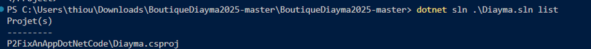

Organisation du projet :

```
P2FixAnAppDotNetCode/
├── Program.cs, Startup.cs          → démarrage et configuration (DI, localisation, routes)
├── Controllers/                    → ProductController, CartController, OrderController, LanguageController
├── Components/                     → CartSummaryViewComponent, LanguageSelectorViewComponent
├── Models/                         → Product, Cart/CartLine, Order
│   ├── Repositories/               → ProductRepository, OrderRepository (données en mémoire)
│   ├── Services/                   → ProductService, OrderService, LanguageService
│   └── ViewModels/                 → LanguageViewModel
├── Views/                          → vues Razor (.cshtml)
├── Resources/                      → traductions (.resx) en, fr, wo
└── wwwroot/                        → CSS, JS, Bootstrap, Font Awesome
```

## 3. Version du SDK .NET (Q3)

Dans `Diayma.csproj` :

```xml
<Project Sdk="Microsoft.NET.Sdk.Web">
  <TargetFramework>netcoreapp2.0</TargetFramework>
  <PackageReference Include="Microsoft.AspNetCore.All" Version="2.0.6" />
```
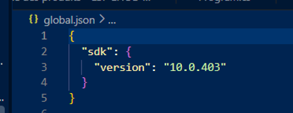


Le projet cible **.NET Core 2.0** (`netcoreapp2.0`) avec ASP.NET Core 2.0.6.
Le SDK correspondant est le **SDK .NET Core 2.1.202**, le dernier de la famille 2.0, qui inclut les runtimes .NET Core 2.0.9 et ASP.NET Core 2.0.9.
Il n'y a pas de fichier `global.json`, donc aucune version de SDK n'est imposée.

## 4. Installation du SDK (Q4)

La bonne version est installes

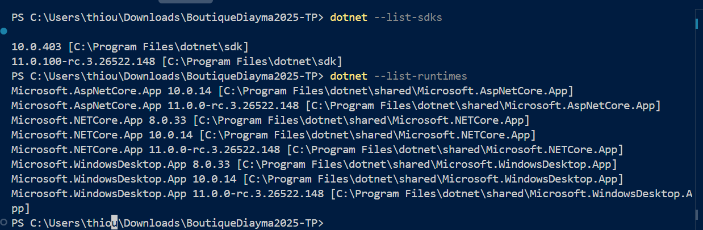

## 5. Dépôt GitHub (Q5)

## 6. Bugs trouvés (Q6)

Les bugs ont été reproduits en lançant l'application, puis corrigés. Chaque correction est commentée `// BUG corrigé` dans le code.

### Bug 1 : le total du panier ignore la quantité

**Reproduction :** ajouter 2 × *XIAOMI Redmi 13C* (88 000) et 1 × *Music Pioneer Bluetooth* (7 000), puis ouvrir le panier.

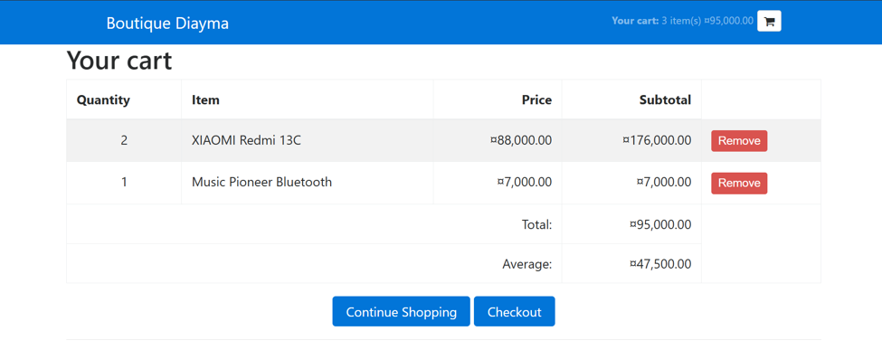

Le bandeau du haut affiche aussi « 3 item(s) 95 000 ».

**Cause :** dans `Models/Cart.cs`, `GetTotalValue()` additionne `Product.Price` sans multiplier par `Quantity`. `GetAverageValue()` fait la moyenne par *ligne* et non par *article*.

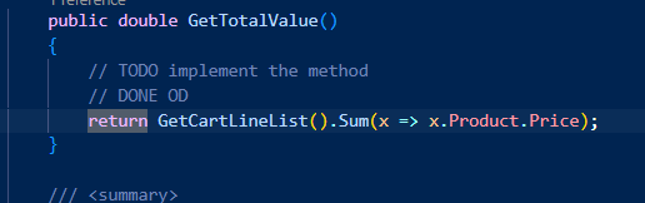

**Correction :**
```csharp
return GetCartLineList().Sum(x => x.Product.Price * x.Quantity);
...
int totalQuantity = GetCartLineList().Sum(x => x.Quantity);
return totalQuantity > 0 ? GetTotalValue() / totalQuantity : 0.0;
```

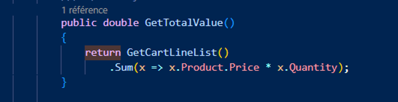

### Bug 2 : le stock ne diminue jamais après une commande

**Reproduction :** commander 2 × *XIAOMI Redmi 13C* (stock 10). Après la commande, la page d'accueil affiche toujours **10** au lieu de **8**. Un produit épuisé réapparaît aussi avec son stock initial.

**Cause :** `ProductRepository` est enregistré en **Transient** dans `Startup` (une nouvelle instance à chaque requête). Son constructeur fait `_products = new List<Product>(); GenerateProductData();`, ce qui **réinitialise la liste statique** à chaque requête et efface les mises à jour de stock.

**Correction :** l'inventaire n'est généré qu'une fois (`if (_products == null)`, protégé par un `lock`). Un produit est retiré quand son stock tombe à `<= 0`.

**Bug lié :** on pouvait mettre au panier plus d'articles que le stock (par exemple 12 Galaxy A25 pour un stock de 10). `CartController.AddToCart` bloque maintenant l'ajout quand la quantité au panier atteint le stock.

### Bug 3 : messages d'erreur affichés en clé brute

**Reproduction :** dans le panier, cliquer *Checkout*, puis valider le formulaire vide. On voit `ErrorMissingName`, `ErrorMissingAddress`… au lieu de « Veuillez renseigner un nom ». Commander avec un panier vide affiche `CartEmpty`. Le problème existe en anglais comme en français.

**Cause :**
- L'assembly s'appelle `Diayma` alors que les classes sont dans `P2FixAnAppDotNetCode`. Le système de localisation cherchait donc la ressource `Diayma.Resources.P2FixAnAppDotNetCode.Models.Order`, qui n'existe pas.
- `Order.*.resx` étaient rangés dans `Resources/Models/ViewModels/` alors que `Order` est dans `Models`. En plus, `Order.en.resx` était exclu de la compilation dans le `.csproj`.

**Correction :** ajout de `<RootNamespace>P2FixAnAppDotNetCode</RootNamespace>` et de `[assembly: RootNamespace("P2FixAnAppDotNetCode")]` (dans `Program.cs`), et déplacement des fichiers dans `Resources/Models/Order.*.resx`.

### Autres anomalies relevées

| Anomalie | Statut |
|---|---|
| Prix affichés en `$`, `€` ou `¤` selon la langue, pour une boutique au Sénégal | Corrigé : prix en **FCFA** (`PriceExtensions.ToFcfa()`) |
| Option *Spanish* proposée, mais aucune traduction : l'interface restait en anglais | Corrigé : remplacée par **Wolof** |
| `FindProductInCartLines` lève une `NullReferenceException` si le produit n'est pas dans le panier | Corrigé (`?.Product`) |
| Le panier (`Cart`) est un **Singleton** : tous les visiteurs partagent le même panier | Non corrigé (il faudrait un panier en session) |

---

## 7. Points d'arrêt (Q7)

Points d'arrêt posés avec **F9** (ou un clic dans la marge grise) :

| | Fichier | Ligne | Instruction |
|---|---|---|---|
| a | `Components/CartSummaryViewComponent.cs` | 12 | `_cart = cart as Cart;` (constructeur) |
| b | `Controllers/ProductController.cs` | 15 | `_productService = productService;` (constructeur) |
| c | `Controllers/OrderController.cs` | 17 | `_cart = pCart;` (constructeur) |
| d | `Controllers/CartController.cs` | 15 | `_cart = pCart;` (constructeur) |
| e | `Startup.cs` | 20 | `Configuration = configuration;` (constructeur) |

a. CartSummaryViewComponent ligne 12
 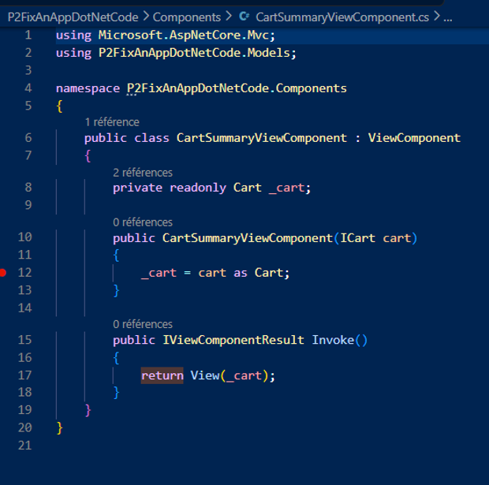
b. ProductController ligne 15
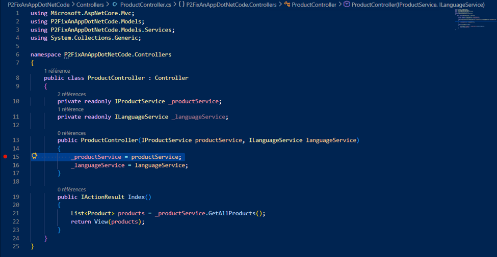
 
c. OrderController ligne 17
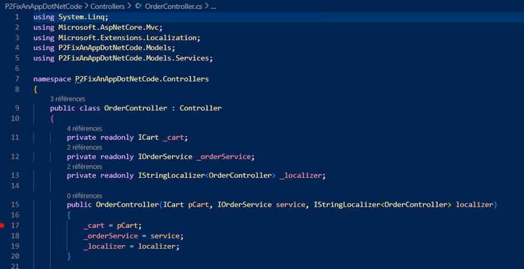
 
d. CartController ligne 15
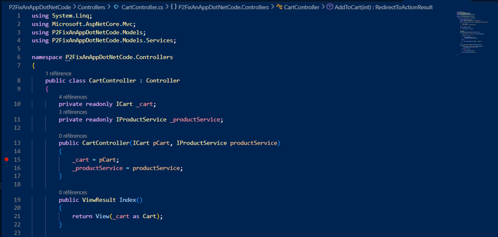
 
e. Startup ligne 20

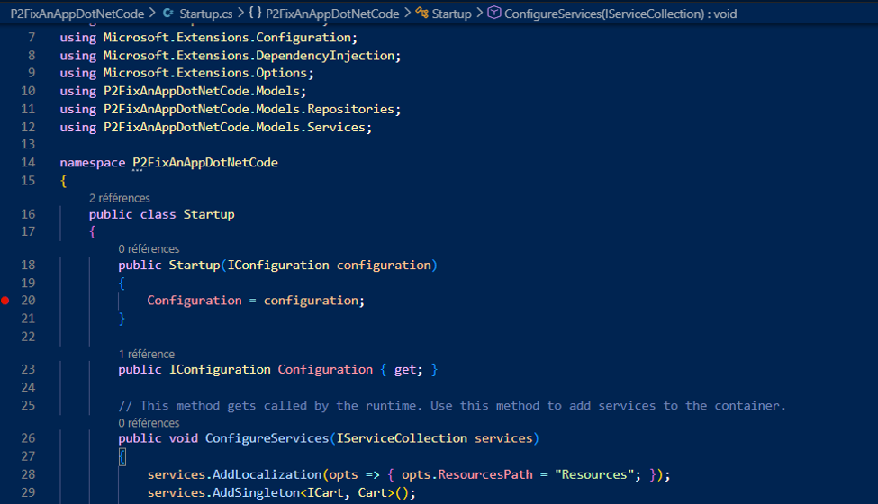


 


Au lancement (F5) puis à l'affichage de l'accueil, les points d'arrêt sont atteints dans l'ordre **e → b → a**.
**c** et **d** ne sont **pas atteints** sur l'écran d'accueil. `OrderController` n'est instancié que sur `/Order` (bouton *Checkout*), et `CartController` que sur `/Cart` ou au clic sur *Ajouter au panier*.

## 8. Chemin d'exécution jusqu'à l'affichage des produits (Q8)

### Modes de pas à pas de Visual Studio

| Mode | Raccourci | Quand l'utiliser |
|---|---|---|
| **Pas à pas détaillé** (*Step Into*) | **F11** | Entrer dans la méthode appelée sur la ligne courante, quand c'est **notre** code |
| **Pas à pas principal** (*Step Over*) | **F10** | Exécuter la ligne sans entrer dedans : appels au framework (`services.AddMvc()`, LINQ…) ou méthodes sans intérêt |
| **Pas à pas sortant** (*Step Out*) | **Maj+F11** | Finir la méthode en cours et revenir à l'appelant (par exemple sortir de `GenerateProductData` ou d'une vue) |

> Avec l'option *« Uniquement mon code »* (activée par défaut), F11 n'entre pas dans le code du framework ASP.NET Core. Quand on sort de notre code vers le framework, le débogueur s'arrête à la ligne suivante de **notre** code.

### Ordre réel d'exécution

L'ordre a été vérifié en instrumentant chaque méthode :

```
Program.Main
Startup.ctor                          ← point d'arrêt e
Startup.ConfigureServices
Startup.Configure
   ── le serveur démarre, le navigateur demande GET / ──
ProductRepository.ctor
ProductRepository.GenerateProductData   (9 × new Product(...))
OrderRepository.ctor
ProductService.ctor
LanguageService.ctor (implicite, Singleton)
ProductController.ctor                ← point d'arrêt b
ProductController.Index
ProductService.GetAllProducts
ProductRepository.GetAllProducts
Views/_ViewStart.cshtml
Views/Product/Index.cshtml            (le tableau des produits est généré)
Views/Shared/_Layout.cshtml
Cart.ctor (implicite, Singleton)
CartSummaryViewComponent.ctor         ← point d'arrêt a
CartSummaryViewComponent.Invoke
Views/Shared/Components/CartSummary/Default.cshtml
LanguageSelectorViewComponent.Invoke
Views/Shared/Components/LanguageSelector/Default.cshtml
   ── la page HTML est envoyée au navigateur : les produits s'affichent ──
```

> Les singletons (`Cart`, `LanguageService`) ne sont créés qu'à la première requête. Depuis la correction du bug 2, `GenerateProductData` ne s'exécute plus qu'une seule fois.

### Détail, étape par étape

| # | Namespace | Classe | Méthode | Mode conseillé |
|---|---|---|---|---|
| 1 | `P2FixAnAppDotNetCode` | `Program` | `Main(string[] args)` | Démarrer avec **F11** au lieu de F5 : arrêt sur la 1ʳᵉ ligne de `Main` |
| 2 | `P2FixAnAppDotNetCode` | `Program` | `BuildWebHost(string[] args)` | **F11** sur `BuildWebHost(args).Run();` |
| 3 | `Microsoft.AspNetCore` / `Microsoft.AspNetCore.Hosting` | `WebHost`, `WebHostBuilder` | `CreateDefaultBuilder`, `UseStartup<Startup>`, `Build` | Code du framework : **F10** |
| 4 | `P2FixAnAppDotNetCode` | `Startup` | `Startup(IConfiguration)` (constructeur) | Arrêt sur le **point d'arrêt e** (ligne 20). **F10** |
| 5 | `P2FixAnAppDotNetCode` | `Startup` | `ConfigureServices(IServiceCollection)` | **F10** sur chaque `services.Add…` : enregistrement DI de `Cart` et `LanguageService` (Singleton), des services et dépôts (Transient), localisation, MVC |
| 6 | `P2FixAnAppDotNetCode` | `Startup` | `Configure(IApplicationBuilder, IHostingEnvironment)` | **F10** : fichiers statiques, localisation, session, route `{controller=Product}/{action=Index}` |
| 7 | `Microsoft.AspNetCore.Hosting` | `WebHostExtensions` | `Run()` | Le serveur Kestrel écoute. Le navigateur envoie `GET /`, routé vers `Product/Index` |
| 8 | `P2FixAnAppDotNetCode.Models.Repositories` | `ProductRepository` | constructeur, puis `GenerateProductData()` | Créés par l'injection de dépendances **avant** le constructeur du contrôleur. Pour les voir, poser un point d'arrêt dans ce constructeur, puis **F11** dans `GenerateProductData` et **Maj+F11** pour en sortir |
| 9 | `P2FixAnAppDotNetCode.Models` | `Product` | `Product(int, int, double, string, string)` × 9 | **F10** (ou F11 une fois pour voir l'initialisation) |
| 10 | `P2FixAnAppDotNetCode.Models.Repositories` | `OrderRepository` | constructeur | Dépendance de `ProductService` |
| 11 | `P2FixAnAppDotNetCode.Models.Services` | `ProductService` | constructeur `(IProductRepository, IOrderRepository)` | Dépendance de `ProductController` |
| 12 | `P2FixAnAppDotNetCode.Models.Services` | `LanguageService` | constructeur implicite | Singleton créé à la 1ʳᵉ requête |
| 13 | `P2FixAnAppDotNetCode.Controllers` | `ProductController` | `ProductController(IProductService, ILanguageService)` | Arrêt sur le **point d'arrêt b** (ligne 15). **F10** jusqu'à la fin |
| 14 | `P2FixAnAppDotNetCode.Controllers` | `ProductController` | `Index()` | **F11** sur `_productService.GetAllProducts()` |
| 15 | `P2FixAnAppDotNetCode.Models.Services` | `ProductService` | `GetAllProducts()` | **F11** sur `_productRepository.GetAllProducts()` |
| 16 | `P2FixAnAppDotNetCode.Models.Repositories` | `ProductRepository` | `GetAllProducts()` | **F10** sur la ligne LINQ (`Where(Stock > 0).OrderBy(Name)`, code `System.Linq`), puis **Maj+F11** deux fois pour remonter dans `Index()` |
| 17 | `Microsoft.AspNetCore.Mvc` | `Controller` | `View(object model)` | **F10** sur `return View(products);` : crée un `ViewResult` |
| 18 | `AspNetCore` (classes générées par Razor) | `_Views__ViewStart_cshtml` puis `_Views_Product_Index_cshtml` | `ExecuteAsync()` | Le débogueur peut entrer dans le `.cshtml`. La boucle `@foreach (Product p in Model)` génère une ligne de tableau par produit. **Maj+F11** pour en sortir |
| 19 | `AspNetCore` | `_Views_Shared__Layout_cshtml` | `ExecuteAsync()` | **F11** sur `@await Component.InvokeAsync("CartSummary")` |
| 20 | `P2FixAnAppDotNetCode.Models` | `Cart` | constructeur implicite (initialisation de `_lignesPanier`) | Singleton créé à ce moment, à la 1ʳᵉ requête |
| 21 | `P2FixAnAppDotNetCode.Components` | `CartSummaryViewComponent` | `CartSummaryViewComponent(ICart)` | Arrêt sur le **point d'arrêt a** (ligne 12). **F10** |
| 22 | `P2FixAnAppDotNetCode.Components` | `CartSummaryViewComponent` | `Invoke()` | **F10** sur `return View(_cart);` |
| 23 | `AspNetCore` | `_Views_Shared_Components_CartSummary_Default_cshtml` | `ExecuteAsync()` | **F11** sur `Model.Lines.Count()` pour entrer dans la propriété `Cart.Lines` (getter). Panier vide : rien n'est affiché à côté de l'icône |
| 24 | `P2FixAnAppDotNetCode.Components` | `LanguageSelectorViewComponent` | `Invoke(ILanguageService)` | Appelé depuis le pied de page du layout. **F10** |
| 25 | `AspNetCore` | `_Views_Shared_Components_LanguageSelector_Default_cshtml` | `ExecuteAsync()` | **Maj+F11**, puis **F5** : la page s'affiche dans le navigateur |

**Récapitulatif des espaces de noms de l'application visités :**

- `P2FixAnAppDotNetCode` : `Program`, `Startup`
- `P2FixAnAppDotNetCode.Controllers` : `ProductController`
- `P2FixAnAppDotNetCode.Models.Services` : `ProductService`, `LanguageService`
- `P2FixAnAppDotNetCode.Models.Repositories` : `ProductRepository`, `OrderRepository`
- `P2FixAnAppDotNetCode.Models` : `Product`, `Cart`
- `P2FixAnAppDotNetCode.Components` : `CartSummaryViewComponent`, `LanguageSelectorViewComponent`
- `AspNetCore` (vues Razor compilées) : `_ViewStart`, `Product/Index`, `_Layout`, `CartSummary/Default`, `LanguageSelector/Default`

Espaces de noms jamais visités pour l'accueil : `OrderController`, `CartController`, `LanguageController`, `OrderService`, `Order`.

---

## 9. Déploiement en exécutable Windows (Q9)

Le projet contient déjà un profil de publication (`Properties/PublishProfiles/FolderProfile.pubxml`) : **Release, win-x64, autonome**.

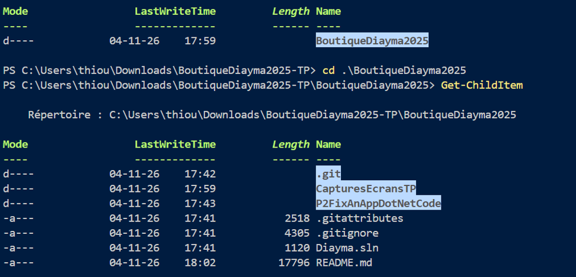
 

on a donc lance l'executable :

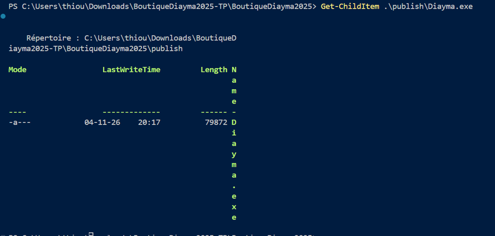


**Lancement :** double-cliquer sur `Diayma.exe`. La console affiche `Now listening on: http://localhost:5000`. Ouvrir <http://localhost:5000> dans un navigateur.

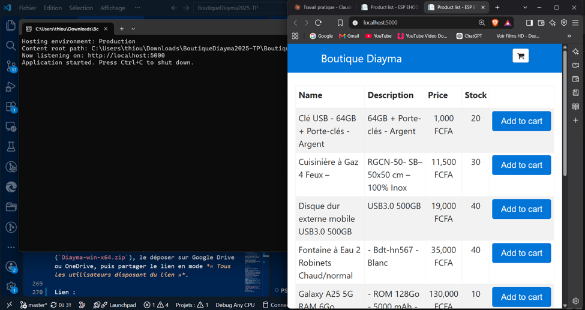

## 10. Lien vers l'exécutable (Q10)

Compresser le dossier de publication (`Diayma-win-x64.zip`), le déposer sur Google Drive ou OneDrive, puis partager le lien en mode *« Tous les utilisateurs disposant du lien »*.

Lien : https://drive.google.com/drive/folders/1lGkRebkyUQO3HXtkme1LZlpFI_fpmx9Q?usp=sharing
---

## 11. Optionnel

### a) Langue wolof

- Fichiers `*.wo.resx` pour toutes les vues, `OrderController` et `Order` (messages de validation).
- Sélecteur de langue : *English / French / **Wolof***. L'option *Spanish*, qui n'avait aucune traduction, a été retirée.
- **Culture française conservée :** choisir *Wolof* écrit le cookie `c=fr|uic=wo`. Les **textes** sont en wolof (`UICulture = wo`) et la **mise en forme** des nombres et dates reste française (`Culture = fr`), par exemple `88 000 FCFA`.
- `Startup` : `wo-SN` et `wo` sont ajoutés aux `SupportedUICultures`. Les `SupportedCultures` (formats) restent anglais et français.

| Clé | Français | Wolof |
|---|---|---|
| ProductList | Liste des produits | Limu marsandiis yi |
| AddToCart | Ajouter au panier | Yokk ci pañe bi |
| YourCart | Votre panier | Sa pañe |
| Price | Prix | Njëg |
| Checkout | Passer la commande | Def komànd bi |
| Thanks | Merci! | Jërëjëf! |
| CartEmpty | Désolé votre panier est vide ! | Baal ma, sa pañe amul dara ! |

### b) Commits

1. `Correction de bugs : total du panier, stocks, messages traduits, prix en FCFA`
2. `Ajout du wolof comme langue d'affichage (culture française conservée)`
3. `README : réponses du TP, bugs, trace pas à pas, déploiement`

### c) Google Classroom

Déposer le lien du dépôt GitHub.
